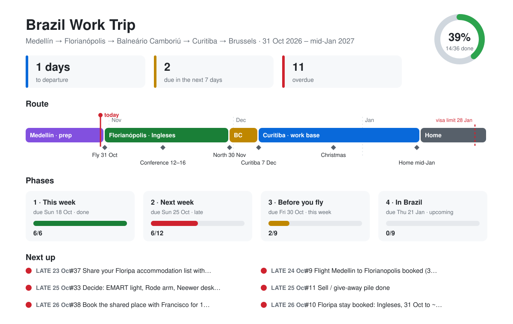

# 🇧🇷 Brazil Work Trip · 31 Oct 2026 → 16–21 Jan 2027

**7/34 done · 21%**

🟩🟩🟩🟩⬜⬜⬜⬜⬜⬜⬜⬜⬜⬜⬜⬜⬜⬜⬜⬜

✈️ **15 days to departure** (Sat 31 Oct)

## ⏰ Overdue

- [ ] [Rio stay booked: 27 Dec to 20 Jan, Botafogo/Flamengo](https://github.com/lennertknippenberg-stack/brazil-trip-2026/issues/1) · was due Thu 15 Oct

## 👉 Next up

- [ ] [Budget Brazil: set the $7,500 plan and a spending tracker](https://github.com/lennertknippenberg-stack/brazil-trip-2026/issues/34) · **Fri 16 Oct**
- [ ] [Travel insurance bought (30 Oct to 21 Jan)](https://github.com/lennertknippenberg-stack/brazil-trip-2026/issues/7) · **Tue 20 Oct**
- [ ] [Flight Medellin to Florianopolis booked (30/31 Oct, with a bag)](https://github.com/lennertknippenberg-stack/brazil-trip-2026/issues/9) · **Wed 21 Oct**
- [ ] [Decide: EMART light, Rode arm, Neewer desk pole (take, store or sell)](https://github.com/lennertknippenberg-stack/brazil-trip-2026/issues/33) · **Sun 25 Oct**
- [ ] [Plug adapter bought (type N/C)](https://github.com/lennertknippenberg-stack/brazil-trip-2026/issues/13) · **Sun 25 Oct**

## 📊 Phases

| Phase | Progress | Done | Due |
| --- | --- | --- | --- |
| [1 · This week](https://github.com/lennertknippenberg-stack/brazil-trip-2026/milestone/1) | 🟩🟩🟩🟩🟩🟩🟩⬜⬜⬜ | 5/7 | Sun 18 Oct |
| [2 · Next week](https://github.com/lennertknippenberg-stack/brazil-trip-2026/milestone/2) | 🟩🟩⬜⬜⬜⬜⬜⬜⬜⬜ | 2/8 | Sun 25 Oct |
| [3 · Before you fly](https://github.com/lennertknippenberg-stack/brazil-trip-2026/milestone/3) | ⬜⬜⬜⬜⬜⬜⬜⬜⬜⬜ | 0/9 | Fri 30 Oct |
| [4 · In Brazil](https://github.com/lennertknippenberg-stack/brazil-trip-2026/milestone/4) | ⬜⬜⬜⬜⬜⬜⬜⬜⬜⬜ | 0/10 | Thu 21 Jan |

## ✅ Recently done

- [x] Ask Francisco: south tour or Rio?
- [x] Panama: yes or no
- [x] Clients or employer OK with working from Brazil
- [x] Medellin subscriptions cancelled
- [x] Landlord: notice given and deposit return agreed

---

**How it works:** every task is an issue. Close it when it's done. This page updates itself every morning and whenever an issue changes.

📄 [Master plan (details, budget, stays)](https://claude.ai/code/artifact/34968c96-3842-4b4a-8ebb-d26ef0847290) · 📅 BRAZIL calendar for times · updated 16 Oct 11:05 (Bogota)
